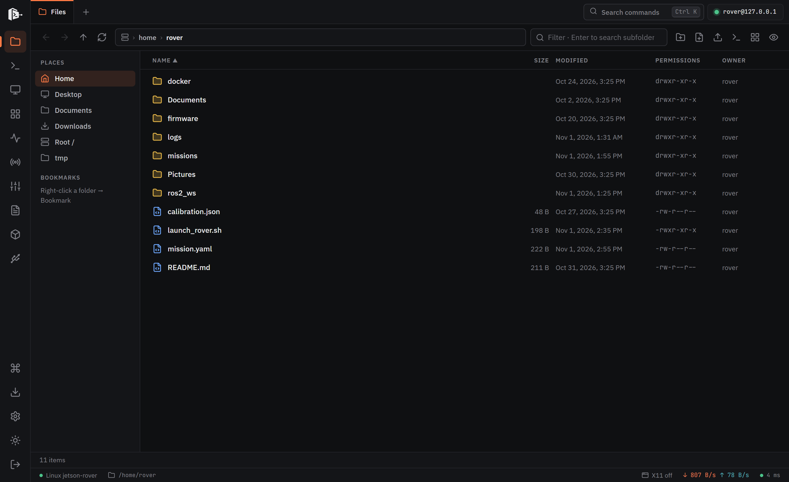
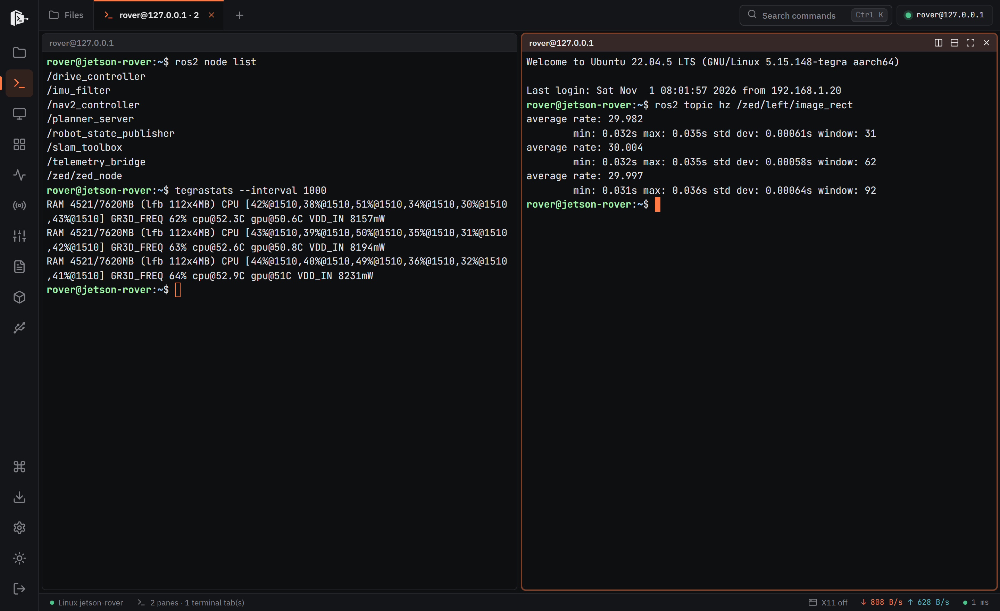
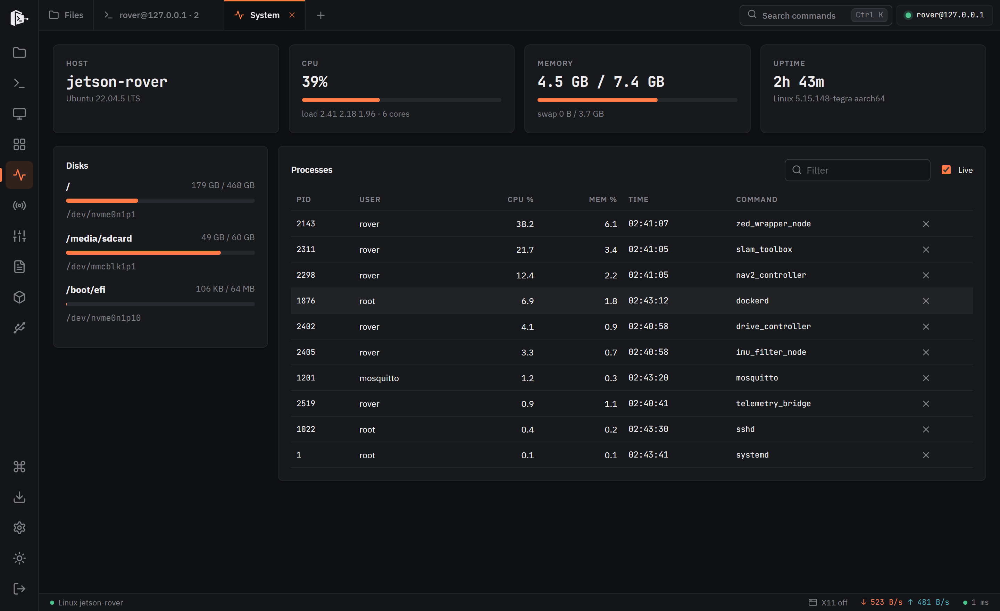
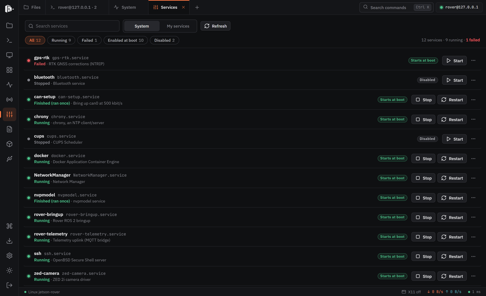
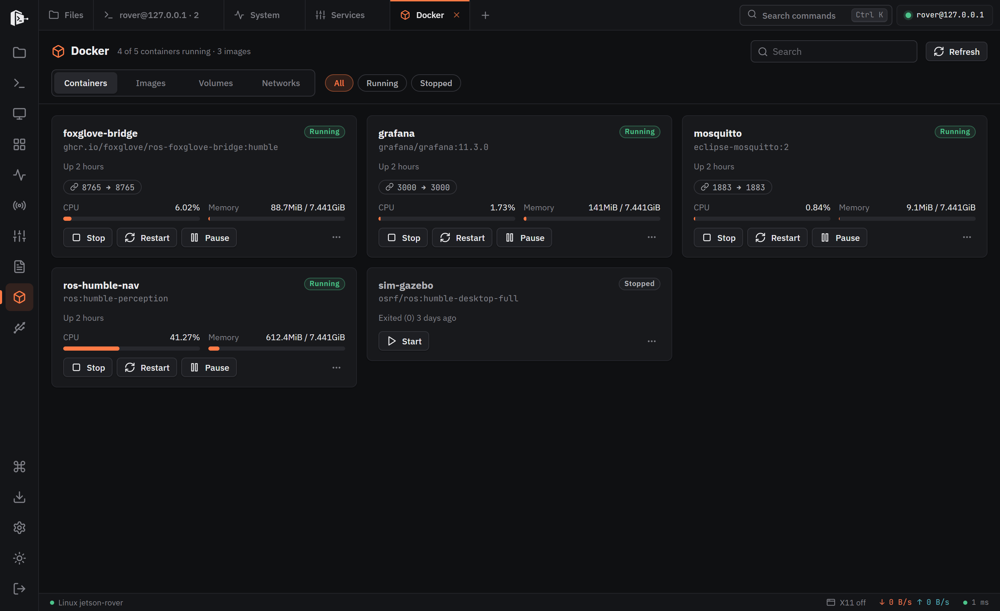
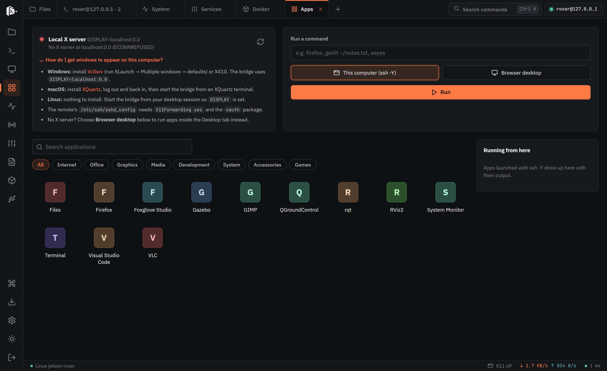
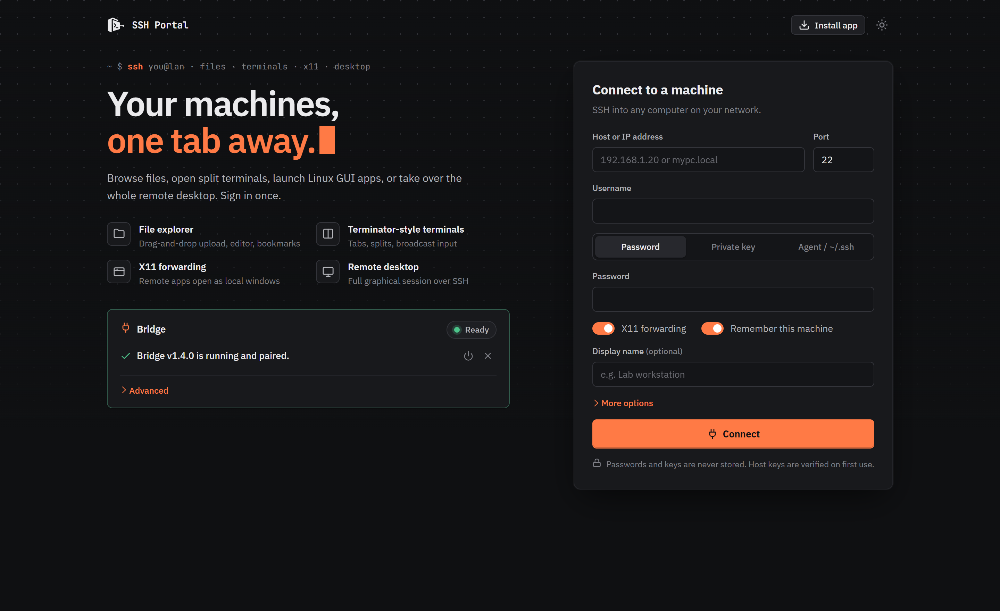

<div align="center">


# SSH Portal

**Use any Linux machine on your network from a browser tab.**

Files, split terminals, GUI apps, a full remote desktop, and live system, service, Docker and network tools, all over the plain SSH you already have. Nothing to install on the remote machine.

[](https://wakifrajin.github.io/ssh-portal/)
[](https://github.com/WakifRajin/ssh-portal/releases/latest)
[](https://github.com/WakifRajin/ssh-portal/actions/workflows/pages.yml)
[](LICENSE)



</div>

## Why

Working on a headless box (a robot's onboard computer, a Raspberry Pi, a lab server, a homelab node) usually means juggling an SSH client, an SFTP client, a VNC viewer and a dozen one-off commands. SSH Portal puts all of it in one tab:

- **No agent on the remote.** It only needs `sshd`. Everything is done through SSH, SFTP and short POSIX `sh` scripts.
- **No cloud relay.** Traffic goes browser → a small bridge on your own PC → SSH. Nothing leaves your network.
- **No build step.** The web app is static HTML and ES modules. Host it on GitHub Pages, any static server, or let the bridge serve it offline.
- **Installs like an app.** It's a PWA with a `web+ssh://` protocol handler, deep links and keyboard shortcuts.

## Screenshots

| | |
|---|---|
|  **Terminals:** tabs, splits, broadcast input |  **System:** CPU, memory, disks, processes |
|  **Services:** systemd units, start/stop/restart, enable at boot |  **Docker:** containers, images, volumes, live stats |
|  **Apps:** launch Linux GUI apps over X11 or into the remote desktop |  **Connect:** password, key or agent auth; saved machines |

<sub>Screenshots use demo data from a mock SSH server (a fictional `jetson-rover`), rendered by the real app.</sub>

## Features

| Area | What you get |
|---|---|
| **Files** | Browse, upload (drag and drop), download files or whole folders as `.tar.gz`, copy/cut/paste, rename, chmod, search, bookmarks, quick look, built-in text editor |
| **Terminals** | xterm.js with tabs, Terminator-style splits, zoom, broadcast input to every pane, search, themes, snippets |
| **GUI apps** | Scans the remote's `.desktop` files and launches them as local windows via X11 forwarding (`ssh -Y`) |
| **Remote desktop** | noVNC over an SSH tunnel. Starts a new virtual desktop or shares the physical screen, and cleans up after itself |
| **System** | Host info, CPU, memory, swap, disks and a live process table with kill |
| **Services** | System and user systemd units: status, start, stop, restart, enable/disable, with sudo prompts when needed |
| **Logs** | Live `journalctl` viewer, also embedded in Services and Docker |
| **Docker** | Docker or Podman containers, images, volumes and networks, live stats, logs, and one-click port forwards |
| **Network** | Interfaces, routes, DNS, listening ports, live bandwidth, ping/traceroute/DNS/whois/HTTP from the remote, port scan, LAN discovery, speed test, Wake-on-LAN |
| **Port forwarding** | Local forwards (`ssh -L`) and a SOCKS5 proxy (`ssh -D`) managed from the UI |
| **Devices** | USB, network links and the switch port behind them (LLDP), neighbours, disks, PCI, Bluetooth |
| **Everywhere** | Command palette (<kbd>Ctrl</kbd>+<kbd>K</kbd>), dark, light and glass themes, data-saver mode, auto-reconnect that restores your tabs |

## Use cases

- **Robotics and embedded:** check ROS nodes, tail a service's journal, restart a driver and pull a rosbag off a Jetson or Pi without plugging in a monitor.
- **Homelab:** one place to manage Docker containers, systemd services and disk space across your machines.
- **Lab and classroom machines:** give people a full Linux desktop from a browser on any OS, using SSH accounts that already exist.
- **Quick fixes from someone else's computer:** the bridge is a single executable that installs for your user only, with no admin rights.

## Quick start

1. Open **[the hosted app](https://wakifrajin.github.io/ssh-portal/)** (or your own copy).
2. In the **Bridge** panel, install the bridge once per computer:
   - **Windows:** click **Download for Windows** and run it. If SmartScreen appears: More info → Run anyway.
   - **macOS / Linux:** paste the one-line command the panel shows into a terminal.
3. Click **Pair this browser**, then **Allow** in the window that opens.
4. Enter host, username and a password or key, then **Connect**. Confirm the host key fingerprint the first time.

The bridge installs for your user only and starts at login. Chrome and Edge may ask to allow access to local network devices: click **Allow**.

To remove it, run it with `--uninstall`:

- **macOS / Linux:** `~/.ssh-portal/bin/ssh-portal-bridge --uninstall`
- **Windows:** `%LOCALAPPDATA%\Programs\SSH Portal\ssh-portal-bridge.exe --uninstall`

### Run from source

Needs Node.js 18+.

```bash
cd bridge
npm install
npm start
```

Then open `http://127.0.0.1:4422/` (it pairs automatically), or use the hosted app and click **Pair this browser**.

### Optional remote setup

**GUI apps on your PC (X11).** You need an X server locally:

| OS | X server |
|---|---|
| Windows | [VcXsrv](https://sourceforge.net/projects/vcxsrv/) (XLaunch → Multiple windows) |
| macOS | [XQuartz](https://www.xquartz.org/) (log out and in after installing, start the bridge from an XQuartz terminal) |
| Linux | already running |

On the remote, set `X11Forwarding yes` in `/etc/ssh/sshd_config` and install `xauth`. No X server? Use the **Desktop** tab instead.

**Remote desktop.** Install one of these on the remote; SSH Portal starts and stops the VNC server itself:

```bash
sudo apt install tigervnc-standalone-server xfce4    # new virtual desktop (recommended)
sudo apt install xvfb x11vnc xfce4                   # alternative
sudo apt install x11vnc                              # share the physical screen
```

**Other tabs.** `lldpd` adds switch/port info to Devices. Docker or Podman enables the Docker tab.

## Architecture

```
┌───────────────────────┐   WebSocket + HTTP    ┌──────────────────────┐      SSH       ┌──────────────────┐
│ Browser tab (web/)    │ ────────────────────► │ Bridge (bridge/)     │ ─────────────► │ Linux machine    │
│ static HTML + ES mods │   127.0.0.1:4422      │ Node.js, on your PC  │  SFTP, exec,   │ just sshd        │
│ xterm.js, noVNC       │ ◄──────────────────── │ ssh2                 │  X11, tunnels  │                  │
└───────────────────────┘                       └──────────────────────┘                └──────────────────┘
```

Browsers can't open raw TCP or SSH connections, so a small local **bridge** does that part:

- **`web/`** is the whole UI: plain ES modules, no bundler, one module per tab (`files.js`, `terminals.js`, `docker.js`, ...). A service worker caches the app shell so it works offline.
- **`bridge/`** is a Node.js server built on [`ssh2`](https://github.com/mscdex/ssh2) and [`ws`](https://github.com/websockets/ws). Each browser session gets one control WebSocket that carries a small JSON request/response protocol (`list`, `term.open`, `sysinfo`, `docker.list`, ...) plus pushed streams (terminal output, logs, tool output).
- **Remote work** runs through SFTP and short POSIX `sh` scripts piped over `exec` ([`remote-scripts.js`](bridge/remote-scripts.js)). Nothing is installed remotely. The only files written are under `~/.ssh-portal/`, for the VNC desktop.
- **GUI apps** use X11 forwarding to your local X server. The **desktop** is a VNC server bound to the remote's `127.0.0.1`, reached through an SSH `direct-tcpip` tunnel and drawn by noVNC.
- **Releases** are single-file executables (Node SEA) built for Windows, macOS and Linux by the [Release bridge](.github/workflows/release-bridge.yml) workflow. The web app's download buttons point at the latest release.

### Security model

- The bridge listens on `127.0.0.1` only and accepts an allowlist of web origins.
- A browser must be **paired** once, by clicking Allow on a page served by the bridge. Its token is compared in constant time.
- Downloads, uploads and VNC tunnels use one-time tickets that expire after 60 seconds.
- Host keys are trust-on-first-use, and a changed key triggers a warning.
- Passwords and private keys are never stored. With X11, the remote only ever sees a fake cookie; the real one stays on your PC.
- Every remote shell argument is single-quote escaped, and hosts, URLs, PIDs and ports are validated before use.

For a file-by-file map, the protocol reference and conventions, see [CODEBASE.md](CODEBASE.md).

## Host your own copy

1. Publish the `web/` folder on any static host. The included [Pages workflow](.github/workflows/pages.yml) deploys it on every push to `main`.
2. In **Actions**, run **Release bridge**. It builds the bridge executables and attaches them to a release; the app's download buttons and install scripts use them.

On a custom domain, set `REPO` in `web/js/config.js` to your `<owner>/<repo>`, and start the bridge with `--origin https://your.domain`.

To build an executable locally: `cd bridge && npm install && node build.mjs` (output in `bridge/dist/`).

## Bridge options

```
ssh-portal-bridge [--install | --uninstall | --background | --foreground] [--no-autostart]
                  [--port 4422] [--origin URL]... [--app-url URL] [--new-token]
```

| Option | Meaning |
|---|---|
| `--port` (`SSH_PORTAL_PORT`) | Listen port, default 4422. If changed, set the same URL under **Advanced** in the app. |
| `--origin` (`SSH_PORTAL_ORIGINS`) | Extra allowed web origins. Localhost is always allowed. |
| `--app-url` (`SSH_PORTAL_APP_URL`) | Your hosted URL, used to print a pairing link. |
| `--install` / `--uninstall` | Add or remove the per-user install and login item. |
| `--no-autostart` | With `--install`: don't start at login. |
| `--background` / `--foreground` | Run without a window (logs in `~/.ssh-portal/bridge.log`) / run in the terminal. |
| `--new-token` | Rotate the pairing token (un-pairs all browsers). |

## Troubleshooting

- **"No bridge found":** check the bridge is running, the port matches **Advanced → Bridge URL**, and you allowed the local-network prompt. Safari blocks this; use Chrome, Edge or Firefox. In Brave, turn off Shields for the page.
- **GUI app doesn't appear:** check the X server status in the Apps tab, `X11Forwarding yes` and `xauth` on the remote, and that `echo $DISPLAY` in an SSH Portal terminal prints something like `localhost:10.0`.
- **Desktop won't start:** the error names the missing package. Logs are in `~/.ssh-portal/` on the remote.

## Contributing

Bug reports, feature ideas and pull requests are welcome. See [CONTRIBUTING.md](CONTRIBUTING.md) for the dev setup, code conventions and how to add a new tab or bridge operation.

## License

[MIT](LICENSE) © 2026 Azwad Wakif Rajin
